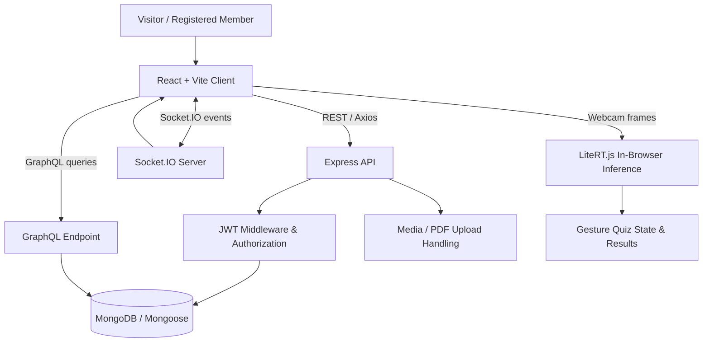

<div align="center">

# 🌐 SkillSphere AI

### Learn together. Build what's next.

**A full-stack, community-powered platform for skill sharing, collaborative learning, events, and interactive AI experiences.**

Share knowledge. Discover people. Learn by doing. Turn ideas into progress.

<p>
  
  
  
  
</p>

**[Why SkillSphere?](#-why-skillsphere-ai)** · **[Features](#-core-features)** · **[AI Lab](#-ai-learning-lab--gesture-controlled-mcq-quiz)** · **[Quick Start](#-getting-started)** · **[API](#-api-overview)**

</div>

---

## ✨ Why SkillSphere AI?

Learning is more effective when people can **share what they know, discover useful resources, meet collaborators, and practice new skills** in the same place. Most tools handle only one part of that journey.

**SkillSphere AI brings those experiences together** through a community feed, searchable learning resources, collaborative events, member profiles, real-time interactions, and an experimental browser-based AI lab.

> **Built as a university Web Technology Sessional project**, SkillSphere AI demonstrates a connected full-stack application with authentication, REST and GraphQL APIs, WebSocket communication, media handling, and on-device machine-learning inference.

### The experience at a glance

| Discover | Participate | Create | Experiment |
|:--|:--|:--|:--|
| Find people, posts, resources, and events | Follow members, react, comment, bookmark, and join events | Publish posts, learning resources, and events | Answer MCQs through hand gestures in the AI Learning Lab |

---

## 🚀 Core Features

### 🗣️ Community & social learning

- **Community feed** with paginated posts and user-authored content.
- **Create, edit, and delete posts** with owner-only edit/delete actions and confirmation before deletion.
- **Text, image, and video posts**, including upload validation and previews.
- **Likes, dislikes, and comments** with real-time Socket.IO updates.
- **Save/bookmark posts** to revisit useful conversations.
- **Profiles and social connections**: edit profile details, upload profile pictures, follow/unfollow users, discover suggested members, and search for users.
- **Online/community presence features** that help participants stay connected.

### 📚 Learning Resource Hub

- Publish and browse **tutorials, YouTube lessons, and PDF learning materials**.
- Use **search, category filters, resource-type filters, and pagination**.
- Share a PDF through a **URL or local file upload**, with format/size validation and upload progress.
- **Rate resources** and view community ratings.
- Authentication-aware **Add Resource** workflow: guests see a reusable *Login Required* dialog; signed-in users can open the publishing form.

### 📅 Events & collaboration

- Explore community events and event details.
- Create events with the existing event-management form.
- Join/leave events and use event discovery/filtering tools.
- Authentication-aware **Create Event** workflow with the same reusable login dialog.
- Event-related information and agenda presentation support collaboration around shared activities.

### 🤖 AI-powered learning

- An interactive **gesture-controlled multiple-choice quiz** using a TensorFlow Lite model in the browser through **LiteRT.js**.
- Webcam-based recognition of **four answer gestures (1–4)** plus a **No Hand** class.
- **Confidence-aware prediction** and a **two-second hold-to-submit** interaction.
- Quiz progress, answer feedback, and score display.
- A dedicated `/ai-lab` experience and an AI Tools entry on the homepage.

### 📊 Developer and data features

- **JWT-based authentication**, protected frontend routes, and authenticated API requests.
- **REST endpoints** for the main application workflows.
- **GraphQL Community Insights** with authenticated queries including `communityOverview` and `apiStatus`.
- **Socket.IO** for live community interactions.
- **Responsive UI** with Tailwind CSS, reusable React components, and GSAP homepage animations.
- **Clear guest vs. authenticated-user experiences** for content-creation actions.

---

## 🧠 AI Learning Lab — Gesture-Controlled MCQ Quiz

The AI Lab demonstrates **hands-free learning interaction**, not just a chatbot interface.

```text
Webcam (user permission)
        │
        ▼
Video frame → 224 × 224 center crop → RGB preprocessing
        │
        ▼
TensorFlow Lite model running in-browser (LiteRT.js / WebAssembly)
        │
        ▼
Gesture probabilities: 1 · 2 · 3 · 4 · No Hand
        │
        ▼
Confidence / stability check
        │
        ▼
Hold answer gesture for 2 seconds → Submit MCQ answer
        │
        ▼
Question feedback + progress + score
```

**Implementation highlights**

- Model and labels are loaded from local public assets such as `public/models/gesture-quiz/model_unquant.tflite` and `labels.txt`.
- Inference runs **locally in the browser**; the quiz uses the webcam only after the user grants permission.
- A **No Hand** class and gesture-release logic help manage answer transitions.
- Quiz state is kept separate from model inference, making the experience easier to test and maintain.

**Try it:** Run the app and open **`/ai-lab`**. A camera-enabled browser is required to use gesture input.

> The AI demo is an educational prototype. Recognition accuracy can vary with lighting, camera quality, framing, and background conditions. It is not a security, accessibility-certification, or biometric-identification system.

---

## 🛠️ Technology Stack

| Layer | Technology | Purpose |
|---|---|---|
| Frontend | React, Vite, JavaScript (JSX) | Component-driven single-page application |
| UI | Tailwind CSS, custom CSS, React Icons | Responsive styling and interface components |
| Motion | GSAP + ScrollTrigger | Landing-page transitions and scroll reveals |
| Navigation | React Router | Public and protected application routes |
| HTTP client | Axios | REST requests and JWT header handling |
| Backend | Node.js, Express | API routes, application logic, middleware |
| Database | MongoDB, Mongoose | Persistent users, posts, resources, and events |
| Authentication | JWT, bcrypt | Authenticated sessions and password hashing |
| Real-time | Socket.IO | Live comments, reactions, and presence |
| API styles | REST + GraphQL (`graphql`, `graphql-http`) | Application operations and community insights |
| Uploads | Multer | Uploaded media/PDF handling |
| AI | TensorFlow Lite + LiteRT.js / WebAssembly | Client-side gesture classification |
| Quality & tooling | ESLint, npm, Git, GitHub | Code checks, scripts, and version control |

The project uses **React/Vite on the client** and **CommonJS-based Node/Express on the server**.

---

## 🏗️ System Architecture



**Design principle:** The server remains responsible for authentication, authorization, validation, and persistent data. The frontend handles interaction and presentation; the gesture model performs its inference in the browser.

---

## 🗂️ Project Structure

The following is a **representative layout of the implemented modules**. Exact filenames can vary as the project evolves.

```text
skillsphere-ai/
├── client/
│   ├── public/
│   │   ├── models/gesture-quiz/     # Local TFLite model and labels
│   │   └── litert-wasm/             # Browser inference runtime assets
│   ├── src/
│   │   ├── components/
│   │   │   ├── common/              # Navbar, LoginRequiredModal
│   │   │   ├── feed/                # FeedCenter, PostCard, Edit/Delete modals
│   │   │   ├── profile/             # Profile UI and editing
│   │   │   └── resources/           # PDF source/upload controls
│   │   ├── context/                 # AuthContext
│   │   ├── data/                    # Quiz questions
│   │   ├── pages/                   # Home, Feed, Resources, Events, AI Lab, etc.
│   │   ├── services/                # Axios API client
│   │   ├── socket/                  # Socket.IO client
│   │   └── utils/                   # Quiz/gesture state logic
│   └── package.json
├── server/
│   ├── config/                     # MongoDB connection
│   ├── controllers/                # Business logic
│   ├── graphql/                    # Schemas and resolvers
│   ├── middleware/                 # JWT protection and authorization
│   ├── models/                     # Mongoose schemas
│   ├── routes/                     # REST and GraphQL routing
│   ├── utils/                      # Shared backend helpers
│   ├── index.js                    # Express / Socket.IO bootstrap
│   └── package.json
├── package.json                    # Concurrent development scripts
└── README.md
```

---

## ⚡ Getting Started

### Prerequisites

- **Node.js and npm** (use a currently supported Node.js LTS version compatible with your installed Vite release).
- **MongoDB** running locally, or a MongoDB connection string from a hosted MongoDB service.
- **Git**, a modern browser, and an available webcam for the optional AI gesture demo.

### 1. Clone the repository

```bash
git clone <YOUR_REPOSITORY_URL>
cd skillsphere-ai
```

If you already have the project locally, open a terminal in the repository root instead.

### 2. Install dependencies

```bash
# Root scripts / concurrently
npm install

# Backend
cd server
npm install

# Frontend
cd ../client
npm install

cd ..
```

### 3. Configure environment variables

Create **`server/.env`**:

```dotenv
PORT=5002
MONGO_URI=mongodb://127.0.0.1:27017/skillsphere_ai
JWT_SECRET=replace_with_a_long_random_secret
```

Create **`client/.env`**:

```dotenv
VITE_API_URL=http://localhost:5002/api
VITE_SOCKET_URL=http://localhost:5002
```

The variable names above match the project's documented configuration. If your backend is running on a different port, **update both frontend URLs to match**.

> **Never commit real `.env` files, JWT secrets, database credentials, or private user data.** Keep `.env` in `.gitignore`. Vite variables prefixed with `VITE_` are client-visible and must **not** contain secrets.

### 4. Start the application

From the **repository root**:

```bash
npm run dev
```

This starts the server and Vite client concurrently using the root `package.json` scripts.

Alternatively, use two terminal windows:

```bash
# Terminal 1 — backend
cd server
npm run dev
```

```bash
# Terminal 2 — frontend
cd client
npm run dev
```

**Local development URLs** (unless changed in your configuration):

| Service | URL |
|---|---|
| Frontend | `http://localhost:5173` |
| REST API base | `http://localhost:5002/api` |
| Backend health/root response | `http://localhost:5002/` |
| Socket.IO server | `http://localhost:5002` |

### 5. First-run walkthrough

1. Register a test account and sign in.
2. Open `/feed`, publish a temporary post, and try reactions and comments.
3. Browse `/resources`; try creating a tutorial or uploading a valid PDF while signed in.
4. Visit `/events` and explore the create/join experience.
5. Open `/ai-lab`, allow camera access, and try the gesture-controlled quiz.
6. Explore the GraphQL-powered Community Insights page while authenticated.

---

## 🧭 Main Application Areas

| Page / experience | Purpose | Access behavior |
|---|---|---|
| `/` | Homepage, product overview, AI Lab showcase | Public |
| `/login` and `/register` | Account sign-in and registration | Public |
| `/feed` | Posts, reactions, comments, bookmarks | Browsing and protected actions depend on route/endpoint rules |
| `/resources` | Learning materials and resource ratings | Browsing public; creation prompts guests to log in |
| `/events` | Event discovery and collaboration | Browsing public; creation prompts guests to log in |
| `/saved-posts` | Bookmarked posts | Account-related experience |
| `/ai-lab` | Gesture-controlled MCQ quiz | Camera permission needed for the interactive demo |
| Community Insights | GraphQL-powered community overview | Authenticated experience |
| Profiles and search | Member profiles, follow/unfollow, discovery | Depends on the particular action |

**Note:** The last two entries describe features, not guaranteed literal URL paths. Refer to `client/src/App.jsx` for the current authoritative route configuration.

---

## 🔌 API Overview

REST endpoints are shown **relative to `/api`**. The list focuses on routes documented in the project implementation; use `server/routes/` as the source of truth for the latest configuration.

| Method | Endpoint | Purpose |
|---|---|---|
| `POST` | `/auth/register` | Create an account |
| `POST` | `/auth/login` | Authenticate and obtain a JWT |
| `GET` | `/posts` | Retrieve paginated feed posts |
| `POST` | `/posts` | Publish a post (authenticated) |
| `PUT` | `/posts/:id` | Update an owned post |
| `DELETE` | `/posts/:id` | Delete an owned post |
| `PUT` | `/posts/:id/like` | Toggle a like |
| `PUT` | `/posts/:id/dislike` | Toggle a dislike |
| `GET` | `/posts/user/:id` | View a member's posts |
| `GET` | `/comments/:postId` | Retrieve comments |
| `POST` | `/comments/:postId` | Add a comment (authenticated) |
| `GET` | `/resources` | Browse/filter learning resources |
| `POST` | `/resources` | Publish a learning resource |
| `PUT` | `/resources/:id/rate` | Rate a resource |
| `GET` | `/resources/:id/my-rating` | Retrieve current user's rating |
| `POST` | `/uploads/image` | Upload a supported image |
| `POST` | `/uploads/video` | Upload a supported video |
| `POST` | `/uploads/pdf` | Upload a supported PDF |

**Additional modules:** Events, profile/following, bookmarks, and GraphQL have their own routes; consult the corresponding server route files to confirm their current method/path combinations rather than relying on an outdated endpoint list.

### GraphQL

SkillSphere AI also uses a **JWT-protected GraphQL layer** for Community Insights, including the `communityOverview` and `apiStatus` queries. Schema definitions and resolvers live in the backend GraphQL module; check its route mount in the current server code for the exact URL and query field arguments.

### Real-time communication

Socket.IO supports per-post update flows. Implemented event names include:

- `joinPost` — subscribe to a post's room.
- `sendLike` / `receiveLike` — distribute reaction changes.
- `sendComment` / `receiveComment` — distribute new comments.

Events and payloads should be validated server-side before trusting them for sensitive operations.

---

## 🔐 Authentication & Security Model

- **JWT authentication** for member sessions; protected backend routes use authorization middleware.
- **Owner-only post modification and deletion** are checked by the backend, not just hidden in the UI.
- **Guest-facing login prompts** protect the user experience for Add Resources and Create Events.
- **Password hashing** via bcrypt.
- **Upload checks** for supported media/PDF types and file sizes.
- **Input validation and error handling** across the main publishing flows.

### Important security distinction

A frontend login modal is **not** a security boundary. Each privileged creation/update/delete API must independently enforce JWT authentication, validation, and resource ownership or permission rules.

For production use, review CORS restrictions, rate limiting, file storage/cleanup, content moderation, session handling, secure deployment, and automated authorization tests.

---

## 🧪 Quality Assurance & Verification

The project has been iteratively checked with **ESLint, Vite builds, backend startup checks, API requests, and manual multi-account workflows**.

### Local checks

```bash
# Frontend lint
cd client
npm run lint

# Frontend production build
npm run build
```

```bash
# Backend startup / smoke check
cd server
npm run dev
```

### Verified functional areas from development testing

- Post owner-only **edit/delete** UI and backend access behavior, including `401`, `403`, `404`, and successful deletion.
- Deletion synchronized with the feed and pagination, including removal from MongoDB.
- Existing create/edit/reaction/comment flows after post deletion changes.
- Guest-vs-member **Add Resource** and **Create Event** modal behavior.
- PDF resource publishing workflow and frontend build checks.
- AI Lab gesture quiz flows and GraphQL Community Insights were implemented and exercised during development.

### Checks still worth completing before a public launch

- Re-run **unauthenticated/invalid-JWT API tests** against the current Resource and Event creation routes.
- Confirm **saved/bookmarked post reference cleanup** after a post is deleted.
- Run end-to-end regression tests, cross-browser/mobile QA, production security review, and load testing.

Passing manual checks does not imply full automated coverage or production security certification.

---

## 🧩 Scope & Future Enhancements

SkillSphere AI is an academic full-stack application and an evolving prototype. Potential next steps include:

- Optional **email/phone verification (OTP)**.
- More automated unit, integration, and end-to-end tests.
- Saved-post reference cleanup and media lifecycle management.
- Richer event reminders, notifications, and attendance workflows.
- Improved AI evaluation across lighting conditions and devices.
- Accessibility improvements and enhanced keyboard/screen-reader interaction.
- Production deployment, security hardening, monitoring, and CI/CD.

The project intentionally focuses on modern web application functionality; it does not depend on relational ERD tooling or Crystal Reports.

---

## 🧑‍💻 Development Workflow

1. Make focused changes in a single module.
2. Run lint/build checks and verify behavior in the browser.
3. Use a second account for permission-sensitive features.
4. Commit changes with a clear, descriptive message.

Example:

```bash
git add README.md
git commit -m "docs: add comprehensive SkillSphere AI project README"
git push origin main
```

> Use your actual branch name if it is not `main`.

---

## 📄 License & Attribution

The original repository root `package.json` declares **ISC** as its package license. If this project will be publicly distributed under ISC, include a matching `LICENSE` file and verify any third-party model/assets have compatible usage rights.

This project was developed for **university coursework and learning**. Frameworks, libraries, model runtimes, and other third-party assets remain subject to their respective licenses.

---

<div align="center">

### SkillSphere AI

**Learn together. Share what you know. Build what comes next.**

Made for curious minds, builders, and lifelong learners.

</div>
